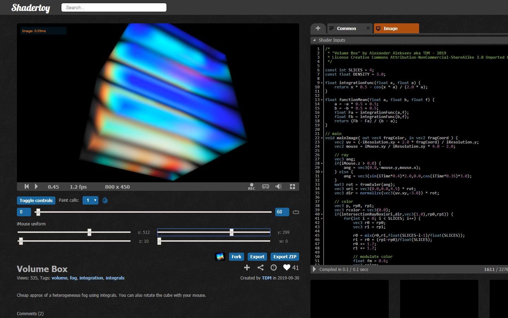
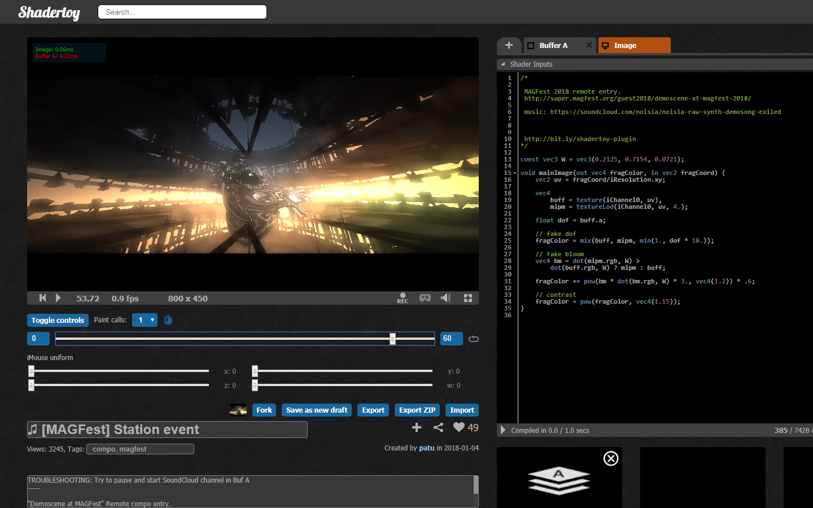
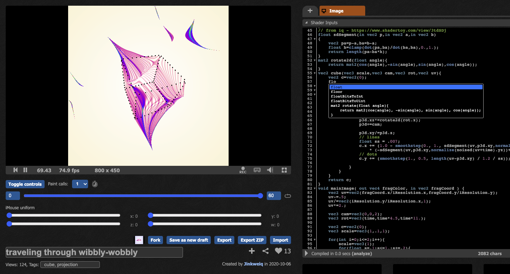
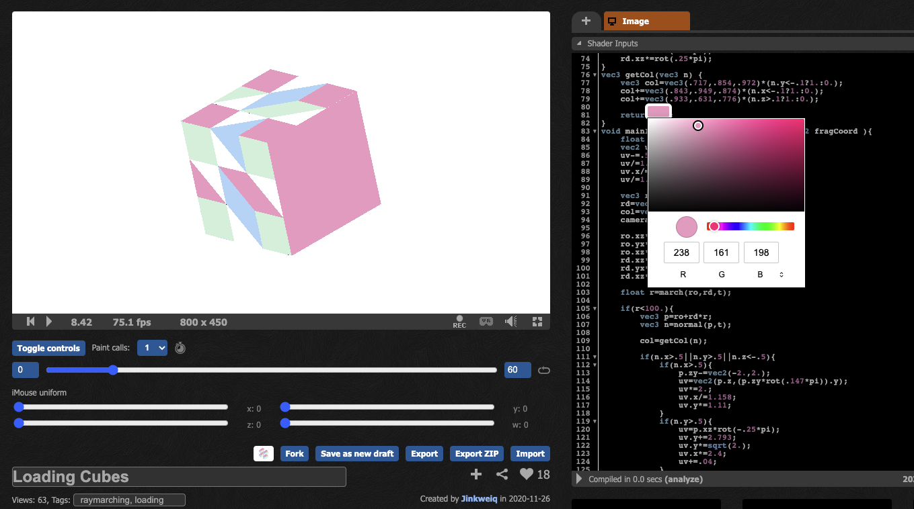
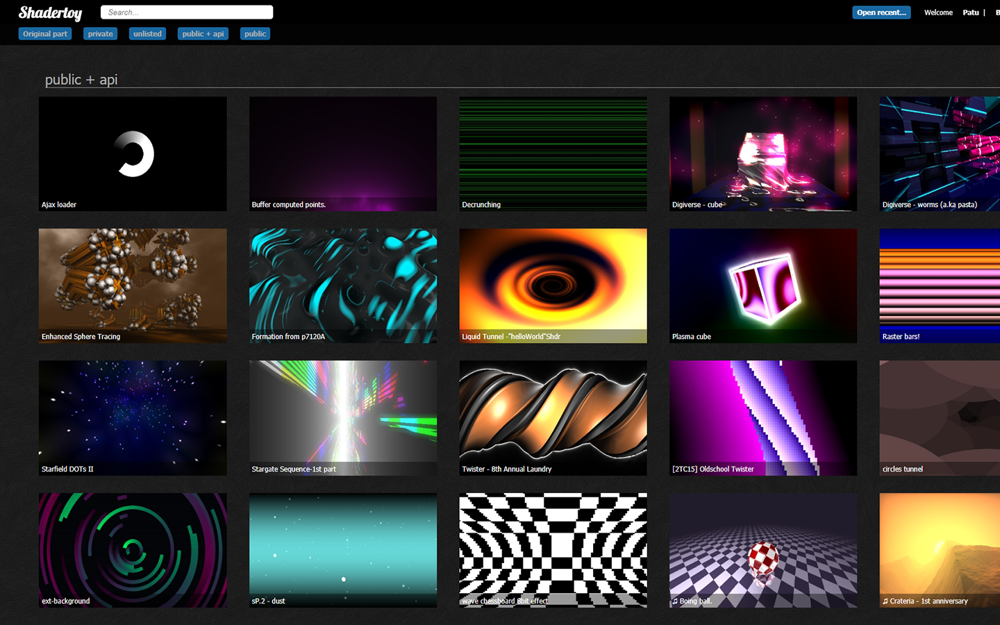
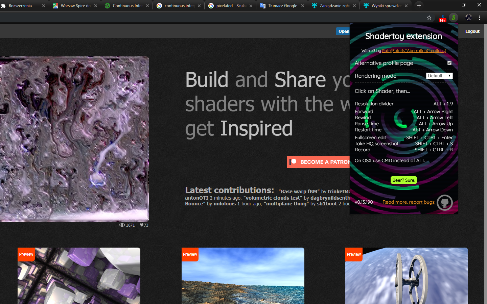
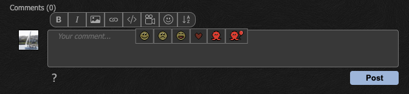
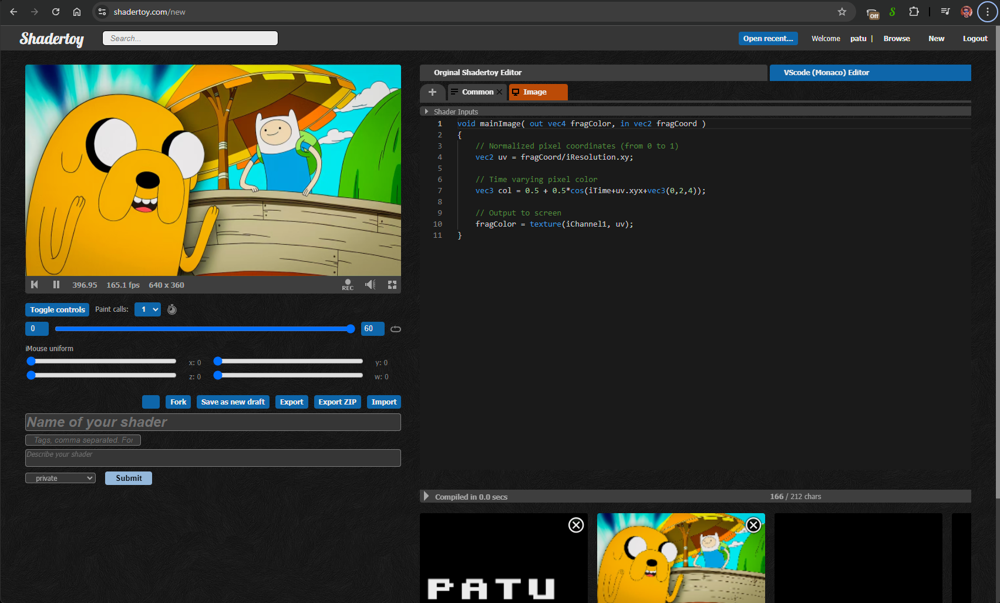
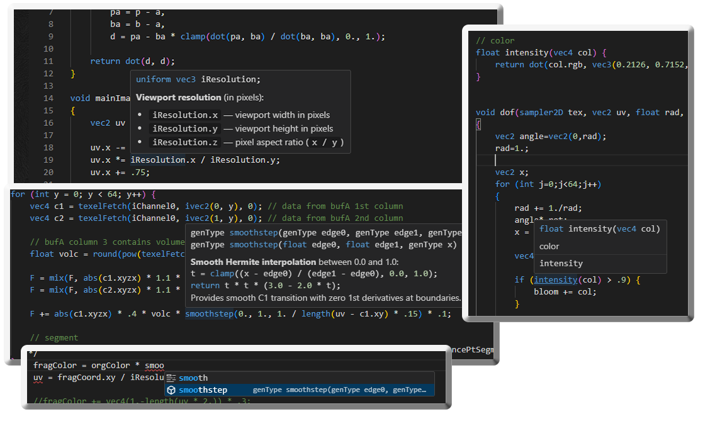

# Shadertoy Unofficial Plugin

A browser extension designed to supercharge the shader development and playback experience on [Shadertoy.com](https://www.shadertoy.com).

---

## Installation

### Web Stores

| Browser             | Store Link                                                                                         |
| :------------------ | :------------------------------------------------------------------------------------------------- |
| **Google Chrome**   | [Chrome Web Store](https://chrome.google.com/webstore/detail/ohicbclhdmkhoabobgppffepcopomhgl)     |
| **Mozilla Firefox** | [Firefox Add-ons (AMO)](https://addons.mozilla.org/firefox/addon/shadertoy-unofficial-plugin/)     |
| **Microsoft Edge**  | [Edge Add-ons](https://microsoftedge.microsoft.com/addons/detail/mjcddpebilehgjibahdplabcocgpfmdb) |

### Manual Installation (Unpacked / ZIP)

Download the latest release zip package from the [Releases](https://github.com/patuwwy/ShaderToy-Chrome-Plugin/releases) page.

<b>Click to expand manual installation instructions</b>

#### Google Chrome / Chromium / Brave / Opera

1. Download and extract the latest extension release ZIP.
2. Navigate to `chrome://extensions/` in your browser.
3. Enable **Developer mode** toggle in the top-right corner.
4. Click **Load unpacked** and select the unzipped directory (or drag and drop).

#### Mozilla Firefox

1. Download and extract the latest extension release ZIP.
2. Navigate to `about:debugging#/runtime/this-firefox`.
3. Click **Load Temporary Add-on…**.
4. Select `manifest.json` from the unpacked folder.

#### Microsoft Edge

1. Download and extract the latest extension release ZIP.
2. Navigate to `edge://extensions/`.
3. Enable **Developer mode** toggle.
4. Click **Load unpacked** and select the unzipped directory.

---

## Features

### 🎮 Player & Canvas Controls

- **Custom Resolution Multiplier:** Adjust resolution dynamically via hotkeys (`ALT + 1..9` to downscale, `ALT + SHIFT + 1..9` to upscale/supersample).
- **Pixelated / Smooth Rendering Modes:** Toggle canvas filtering mode directly from the extension popup.
- **`iTime` Playback Controls:** Interactive slider for `iTime` and media channel seeking, plus loop interval ranges.
- **`iMouse` Simulator:** Four interactive sliders to manipulate `iMouse.xyzw` coordinates for testing and parameter tuning.
- **Fullscreen Playback & Fullscreen Edit Mode:** Smooth canvas handling with dedicated shortcut triggers.
- **Capture HQ Screenshot & Video Recording:** Fast high-res screenshot capture (<kbd>SHIFT</kbd> + <kbd>CTRL</kbd> + <kbd>S</kbd>) and deterministic,
  frame-accurate offline video recording with selectable framerates (50, 60, 120, 144, 240 FPS) powered by WebCodecs & `webm-muxer` (<kbd>ALT</kbd> +
  <kbd>SHIFT</kbd> + <kbd>R</kbd>).

### 🛠️ Code Editor & Shader Tools

- **Monaco Editor GLSL IntelliSense & Autocomplete:** Full autocompletion for GLSL built-in functions, keywords, vector swizzles, ShaderToy uniforms, and snippets (`CTRL + M` or `.`, `#` triggers).
- **Go to Definition & Symbol Navigation:** Jump directly to definitions (<kbd>F12</kbd> or <kbd>CTRL</kbd> + Click) for user-defined functions, structs, `#define` macros, and variables; quick outline symbol search via <kbd>CTRL</kbd> + <kbd>SHIFT</kbd> + <kbd>O</kbd>.
- **Rich Hover Tooltips & Signatures:** Hover over any built-in GLSL function or user-defined function, struct, macro, or variable to inspect full GLSL signatures, descriptions, and parameter types across passes (including the `Common` tab).
- **Signature Help & Parameter Hints:** Interactive parameter hints showing the active argument while typing function calls (`(` and `,`).
- **Live Diagnostics & Compilation Error Squiggles:** On-the-fly background syntax and type checking with inline squiggles and tooltips before compiling.
- **Custom Parameters Block:** Inject external images/textures and customize canvas resolutions via a JSON comment block in the `Common` tab. [Read Custom Parameters Documentation](./docs/custom-params.md).
- **Interactive Color Picker:** Direct color picking for `vec3` declarations containing RGB float values.
- **BBCode Helper Buttons:** Quick formatting toolbar for shader descriptions and comments.
- **Fork Any Shader:** Fork any public shader directly with one click.
- **Save as New Draft:** Duplicate owned shaders into fresh drafts without overwriting the original.

### ⏱️ Profiling & Data Management

- **GPU Render Timers:** High-precision WebGL2 render timing via `EXT_disjoint_timer_query_webgl2`.
- **Render Call Multiplier:** Multi-pass execution control for stress testing and benchmark comparisons.
- **Export & Import Shaders:** Export shaders as single JSON or complete ZIP archives (including `readme.txt`); import JSON shader files.
- **Auto Shader Previews:** Automatic local shader thumbnail generator.

### 👤 Profile & Navigation

- **Alternative Profile Page:** Modern grid layout grouping your shaders by status with high-resolution previews.
- **Open Recent:** Fast access dropdown to recently viewed personal shaders.
- **Rich Links:** Automatically activates links in shader descriptions and comments even without BBCode tags.

---

## Keyboard Shortcuts

> [!NOTE] On macOS, use <kbd>CMD</kbd> instead of <kbd>ALT</kbd>.

### Canvas & Player (Click canvas first)

| Shortcut                                                         | Action              | Description                                                                               |
| :--------------------------------------------------------------- | :------------------ | :---------------------------------------------------------------------------------------- |
| <kbd>ALT</kbd> + <kbd>1</kbd> .. <kbd>9</kbd>                    | Decrease Resolution | Divides canvas resolution by the number pressed (e.g., `2` &rarr; 50%, `8` &rarr; 12.5%). |
| <kbd>ALT</kbd> + <kbd>SHIFT</kbd> + <kbd>1</kbd> .. <kbd>9</kbd> | Increase Resolution | Multiplies canvas resolution for high-detail / supersampling.                             |
| <kbd>ALT</kbd> + <kbd>&rarr;</kbd> / <kbd>&larr;</kbd>           | Forward / Rewind    | Advances or rewinds shader playback time.                                                 |
| <kbd>ALT</kbd> + <kbd>&uarr;</kbd> / <kbd>&darr;</kbd>           | Pause / Restart     | Pauses time uniform or restarts shader from frame 0.                                      |
| <kbd>SHIFT</kbd> + <kbd>CTRL</kbd> + <kbd>Enter</kbd>            | Fullscreen Edit     | Toggles fullscreen editing mode.                                                          |
| <kbd>SHIFT</kbd> + <kbd>CTRL</kbd> + <kbd>S</kbd>                | Take HQ Screenshot  | Captures current frame in high resolution.                                                |
| <kbd>ALT</kbd> + <kbd>SHIFT</kbd> + <kbd>R</kbd>                 | Record Video        | Starts/stops deterministic canvas video recording.                                        |

### Code Editor

| Shortcut / Trigger                                               | Action              | Description                                                                               |
| :--------------------------------------------------------------- | :------------------ | :---------------------------------------------------------------------------------------- |
| <kbd>CTRL</kbd> + <kbd>M</kbd>                                   | Code Completion     | Triggers GLSL autocomplete suggestions.                                                   |
| <kbd>F12</kbd> or <kbd>CTRL</kbd> + Click                        | Go to Definition    | Jumps to definition of function, struct, macro, or variable.                              |
| <kbd>CTRL</kbd> + <kbd>SHIFT</kbd> + <kbd>O</kbd>                | Symbol Outline      | Opens Quick Open symbol outline search in current file.                                   |
| Hover over symbol                                                | Hover Tooltips      | Displays GLSL signature, documentation, and parameter types.                             |
| Type `(` or `,`                                                  | Parameter Hints     | Displays active function signature and highlights current parameter.                      |
| Cursor on `vec3(r, g, b)`                                        | Color Picker        | Pops up an inline visual color picker.                                                    |

---

## Screenshots

|         Controls & `iMouse` Sliders         |               `iTime` Range & Looping                |
| :-----------------------------------------: | :--------------------------------------------------: |
|  |  |

|                    Code Completion                    |            Interactive Color Picker             |
| :---------------------------------------------------: | :---------------------------------------------: |
|  |  |

|                 Alternative Profile Layout                  |         Extension Popup & Settings         |
| :---------------------------------------------------------: | :----------------------------------------: |
|  |  |

|               BBCode Comment Buttons                |           Custom Parameter Textures           |
| :-------------------------------------------------: | :-------------------------------------------: |
|  |  |

|     Monaco Editor features Comment Buttons      |
| :---------------------------------------------: |
|  |

---

## Contributing & Reporting Issues

- Bug reports, feedback, and feature suggestions are welcome via [GitHub Issues](https://github.com/patuwwy/ShaderToy-Chrome-Plugin/issues).
- Please open an issue discussing your proposed changes before submitting a pull request.
- Review [PRIVACY-POLICY.md](PRIVACY-POLICY.md) for details on permissions and privacy.

---

## Credits & Contributors

- **Author:** [Patryk Falba (Patu)](http://patrykfalba.pl)
- **Contributors:**
    - [movAX13h](http://blog.thrill-project.com/)
    - [cxw42](https://github.com/cxw42)
    - [Ethan Lowenthal](https://ethansawesomewebsite.tk/)
    - [Ahsen Khan](https://github.com/ahs3n)
    - GPU render timing based on
      [shadertoy_gpu_timing.user.js](https://github.com/andrei-drexler/shadertoy-userscripts/blob/master/shadertoy_gpu_timing.user.js) by
      [Andrei Drexler](https://github.com/andrei-drexler)
    - Video muxing powered by [webm-muxer](https://github.com/vanilagy/webm-muxer) by [Vanilagy](https://github.com/vanilagy)

---

## Support

If you find this extension helpful in your shader workflow, consider buying a coffee or a beer! ☕🍺

---

## Changelog

Detailed release history and version notes can be found in [CHANGELOG.md](CHANGELOG.md).
