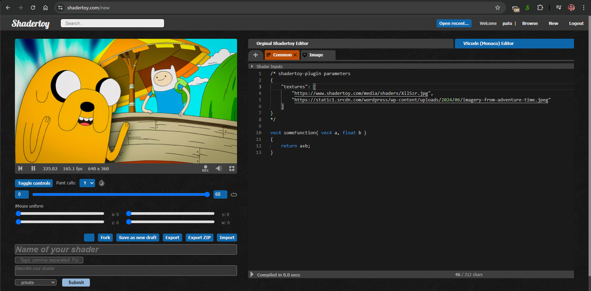

# Custom Parameters

Shadertoy Plugin allows configuring shader execution using a JSON parameter block placed in the **`Common`** tab.

> [!NOTE]
> Custom parameters must be placed inside a comment block starting with `/* shadertoy-plugin parameters` in the `Common` tab.
> They are evaluated when the shader loads and whenever the **Compile (ALT+Enter)** button is clicked.

```c
/* shadertoy-plugin parameters
{
    "textures": [
        "https://www.shadertoy.com/media/shaders/XllSzr.jpg"
    ],
    "canvas": {
        "width": 800,
        "height": 800
    }
}
*/
```

---

## Supported Parameters

| Parameter | Type | Required | Description | Example |
| :--- | :--- | :--- | :--- | :--- |
| `textures` | `string[]` | No | List of image URLs or Base64 data URIs replacing textures in the `Image` tab (`iChannel0`, `iChannel1`, etc., based on array index). | `["https://...", "data:image/png;base64,..."]` |
| `canvas` | `object` | No | Object containing custom canvas resolution settings (`width` and `height`). | `{"width": 800, "height": 600}` |
| `canvas.width` | `integer` | Yes* | Width of the canvas in pixels (*required if `canvas` object is provided). | `800` |
| `canvas.height` | `integer` | Yes* | Height of the canvas in pixels (*required if `canvas` object is provided). | `600` |

---

## Detailed Usage

### 1. Custom Textures (`textures`)

Replaces texture inputs in the `Image` tab sequentially:
- Index `0` &rarr; `iChannel0`
- Index `1` &rarr; `iChannel1`
- Index `2` &rarr; `iChannel2`
- Index `3` &rarr; `iChannel3`

```c
/* shadertoy-plugin parameters
{
    "textures": [
        "https://www.shadertoy.com/media/shaders/XllSzr.jpg",
        "https://i.postimg.cc/Y98KxTJm/16c834b69c07d3ca51f6deb2ca47df8c.jpg"
    ]
}
*/
```

> [!IMPORTANT]
> **CORS Requirements:** External images **must** be served with the `Access-Control-Allow-Origin: *` HTTP header, or hosted directly on `www.shadertoy.com`.
> Popular image hosting services with CORS support include Imgur, PostImages, and Giphy.

> [!TIP]
> **Base64 Data URLs:** Base64-encoded images (`data:image/png;base64,...`) are supported and avoid CORS issues.

> [!WARNING]
> Animated GIFs are not animated (only the first frame is loaded).

#### Screenshots

| `Common` tab definition | `Image` tab result (`iChannel1`) |
| :---: | :---: |
|  |  |

---

### 2. Canvas Resolution (`canvas`)

Resizes the Shadertoy WebGL canvas and internal rendering buffers to an exact custom resolution (`width` &times; `height`).

```c
/* shadertoy-plugin parameters
{
    "canvas": {
        "width": 800,
        "height": 800
    }
}
*/
```

- Both `width` and `height` must be integers.
- Resizes both the viewport display and internal buffers (`mE.ResizeBuffers` and `iSetResolution`).
- The canvas aspect ratio is adjusted automatically.
